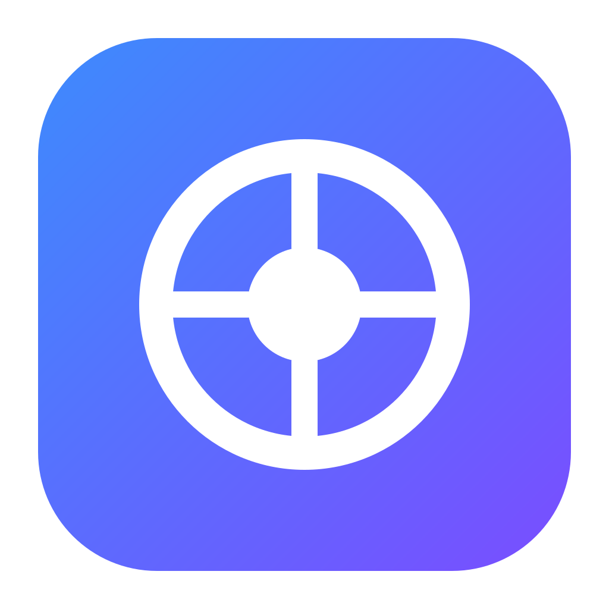

<div align="center">



# Bens

**A fast, lightweight desktop IDE for Kubernetes.**

Browse and edit any resource, stream logs, open shells, forward ports, manage Helm, Flux and Argo CD —
in a native app built with Rust and Tauri.

[](https://github.com/Suro4ek/bens/actions/workflows/build.yml)
[](LICENSE)

[Install](#installation) · [Features](#features) · [Build from source](#building-from-source) · [Contributing](#contributing)

</div>

---

## Why Bens?

- **Native and small.** A ~10 MB installer instead of a bundled browser runtime. The UI runs in the system
  webview; everything that talks to Kubernetes is Rust.
- **Talks to the API server directly.** Watches, logs and exec go straight from [`kube-rs`](https://kube.rs)
  to your cluster — no local proxy process per cluster.
- **Your kubeconfig stays yours.** Bens reads your existing kubeconfig files and never rewrites them unless
  you explicitly edit a context (a backup is kept).
- **No account, no telemetry.** Everything stays on your machine.

## Features

**Cluster browsing**
- Catalog of all contexts from `~/.kube`, `$KUBECONFIG`, extra synced files/folders and pasted kubeconfigs.
- Navigator tree, tabs, back/forward history and a command palette (`⌘K` / `Ctrl+K`).
- Live tables for every resource type, including CRDs: search (case-sensitive and regex), sorting,
  namespace filter, bulk delete, export to CSV.
- Right-click (or `⋮`) menu on every row: logs, shell, scale, restart, cordon/drain, trigger CronJobs,
  edit, delete, and more.
- Details panel with properties, conditions, containers, ports, owner links, related pods and events.

**Workloads and debugging**
- Logs: follow, previous containers, timestamps, filter with highlighting, and merged logs across all
  containers of a pod or all pods of a Deployment / StatefulSet / DaemonSet / Job.
- Shell into containers, root shell on nodes, and a local terminal bound to the selected cluster.
- Port forwarding for pods and services.
- Built-in YAML editor (syntax highlighting, folding, search) and `Create` from YAML with server-side apply.

**Ecosystem**
- **Helm:** releases (read directly from the cluster), values, manifests, history, rollback, uninstall,
  repository management and chart install.
- **Flux** and **Argo CD** dashboards with reconcile / suspend / sync / refresh actions.
- **Metrics:** metrics-server usage in tables, and Prometheus charts for the cluster, nodes and pods
  (auto-detected and queried through the API server's service proxy — no port-forward needed).
- **Cost monitoring:** per-namespace cost, idle share and efficiency from Kubecost or OpenCost, or an estimate
  from Prometheus usage with configurable rates and currency.
- **Device resources** (Dynamic Resource Allocation): resource claims, claim templates, device classes and
  resource slices, with device allocation shown on nodes and pods.

**Settings**
- Per-cluster name, icon and color, HTTP/SOCKS5 proxy, terminal namespace, accessible namespaces,
  Prometheus and cost settings, node shell image.
- Light, dark and system themes; terminal and editor fonts.

## Installation

Download the latest installer for your platform from the **[Releases](https://github.com/Suro4ek/bens/releases)** page.

| Platform | File | Notes |
|---|---|---|
| macOS (Apple Silicon) | `Bens_<version>_aarch64.dmg` | M1 and newer |
| macOS (Intel) | `Bens_<version>_x64.dmg` | |
| Windows | `Bens_<version>_x64-setup.exe` or `.msi` | Windows 10/11, uses WebView2 |
| Linux | `.AppImage`, `.deb` or `.rpm` | x86_64, needs WebKitGTK 4.1 |

### macOS

1. Open the `.dmg` and drag **Bens** into **Applications**.
2. Release builds are not notarized yet, so macOS will refuse to open the app the first time. Either
   right-click **Bens** in Applications and choose **Open**, or remove the quarantine flag:

   ```sh
   xattr -dr com.apple.quarantine /Applications/Bens.app
   ```

### Windows

Run the `-setup.exe` (or the `.msi`). If SmartScreen warns about an unrecognized app, click
**More info → Run anyway**. WebView2 is preinstalled on Windows 10/11; the installer fetches it if missing.

### Linux

**AppImage** (any distribution):

```sh
chmod +x Bens_*_amd64.AppImage
./Bens_*_amd64.AppImage
```

**Debian / Ubuntu:**

```sh
sudo apt install ./Bens_*_amd64.deb
```

**Fedora / RHEL / openSUSE:**

```sh
sudo dnf install ./Bens-*.x86_64.rpm
```

### Requirements

- Access to a cluster through a kubeconfig. Exec-based credentials (`aws`, `gcloud`, `yc`, `kubelogin`, …)
  work as long as the tool is on your shell's `PATH` — on macOS and Linux Bens picks up the `PATH` of your
  login shell.
- Optional: `helm` on `PATH` for rollback, uninstall and chart installation (listing releases does not need it).

## Usage

1. Start Bens. The catalog lists every context found in `~/.kube` and `$KUBECONFIG`.
   Use **+ Add cluster** to sync another file or folder, or to paste a kubeconfig.
2. Click a cluster to connect. Pick a section in the Navigator, or press `⌘K` / `Ctrl+K` to jump anywhere.
3. Select a row to open its details; right-click it for actions. The dock at the bottom holds logs,
   shells, terminals and editors.

| Shortcut | Action |
|---|---|
| `⌘K` / `Ctrl+K` | Command palette |
| `⌘[` / `⌘]` | Back / forward |
| `⌘W` | Close tab |
| `` ⌘` `` | Cluster terminal |
| `⌘N` | Create resource from YAML |
| `⌘,` | Preferences |

On Windows and Linux use `Ctrl` instead of `⌘`.

### Where data is stored

Preferences and the list of synced kubeconfig paths are kept in the app's config directory; pasted
kubeconfigs are stored there with `0600` permissions.

| OS | Location |
|---|---|
| macOS | `~/Library/Application Support/dev.bens.app/` |
| Linux | `~/.config/dev.bens.app/` and `~/.local/share/dev.bens.app/` |
| Windows | `%APPDATA%\dev.bens.app\` |

## Building from source

### Prerequisites

- [Node.js](https://nodejs.org) 20 or newer
- [Rust](https://rustup.rs) 1.90 or newer
- Platform dependencies for Tauri 2 — see the [Tauri prerequisites](https://v2.tauri.app/start/prerequisites/).
  On Debian/Ubuntu:

  ```sh
  sudo apt install libwebkit2gtk-4.1-dev libayatana-appindicator3-dev librsvg2-dev patchelf build-essential
  ```

### Development

```sh
git clone https://github.com/Suro4ek/bens.git
cd bens
npm install
npm run tauri dev
```

### Production build

```sh
npm run tauri build
```

Installers are written to `src-tauri/target/release/bundle/`.

### Checks

```sh
npx tsc --noEmit                                  # frontend types
cargo test --manifest-path src-tauri/Cargo.toml   # backend tests
```

## Project structure

```
src/               React + TypeScript frontend
  components/      UI: navigator, tables, details panel, dock, dashboards, settings
src-tauri/         Rust backend (Tauri 2)
  src/             cluster connection, watches, logs/exec, port-forward, Helm, Prometheus, preferences
.github/workflows/ CI builds for Linux, macOS and Windows
```

## Releasing

The [Build](.github/workflows/build.yml) workflow builds Linux, macOS (Apple Silicon and Intel) and Windows
bundles on every push and pull request and uploads them as workflow artifacts.

To publish a release:

1. Bump the version in `package.json`, `src-tauri/Cargo.toml` and `src-tauri/tauri.conf.json`.
2. Commit, then push a tag:

   ```sh
   git tag v0.2.0
   git push origin v0.2.0
   ```

3. The workflow creates a **draft release** with all installers attached. Review it and click **Publish**.

### Code signing (macOS)

Without signing, macOS shows a warning on first launch. With an Apple Developer Program membership the
workflow signs the app with your **Developer ID Application** certificate and notarizes it, so it opens
on any Mac without warnings. Add these repository secrets (**Settings → Secrets and variables → Actions**):

| Secret | Value |
|---|---|
| `APPLE_CERTIFICATE` | The Developer ID Application certificate exported as `.p12`, base64-encoded: `base64 -i cert.p12 \| pbcopy` |
| `APPLE_CERTIFICATE_PASSWORD` | The password set when exporting the `.p12` |
| `APPLE_SIGNING_IDENTITY` | e.g. `Developer ID Application: Your Name (TEAMID1234)` — see `security find-identity -v -p codesigning` |
| `APPLE_ID` | Your Apple ID email |
| `APPLE_PASSWORD` | An [app-specific password](https://account.apple.com) for that Apple ID |
| `APPLE_TEAM_ID` | Your 10-character Team ID |

Instead of `APPLE_ID` / `APPLE_PASSWORD` / `APPLE_TEAM_ID` you can notarize with an App Store Connect API key:
`APPLE_API_KEY` (key ID), `APPLE_API_ISSUER` (issuer ID) and `APPLE_API_KEY_P8` (contents of the `.p8` file).

## Contributing

Contributions are welcome — bug reports, feature ideas and pull requests.

1. Fork the repository and create a branch.
2. Make your change; keep the style of the surrounding code.
3. Run the checks above.
4. Open a pull request describing what changed and why.

For larger changes, please open an issue first to discuss the approach.

## Acknowledgements

Bens is built on [Tauri](https://tauri.app),
[kube-rs](https://kube.rs), [React](https://react.dev), [CodeMirror](https://codemirror.net),
[xterm.js](https://xtermjs.org) and [Lucide](https://lucide.dev) icons.

## License

Bens is licensed under the [Apache License, Version 2.0](LICENSE).
